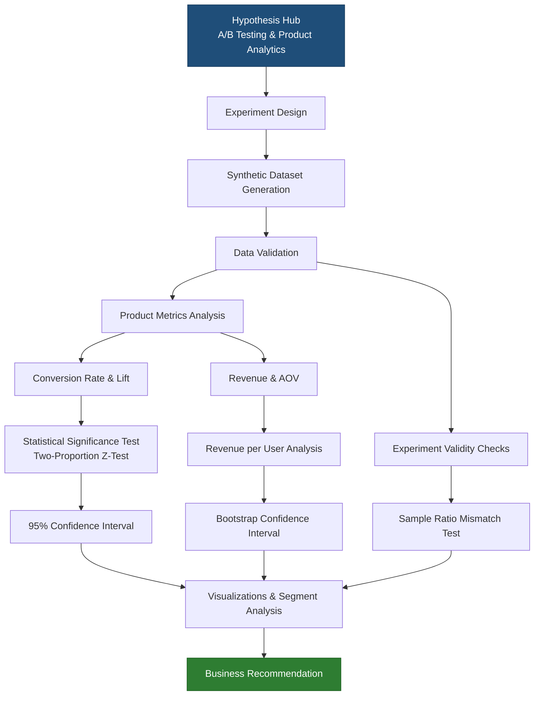
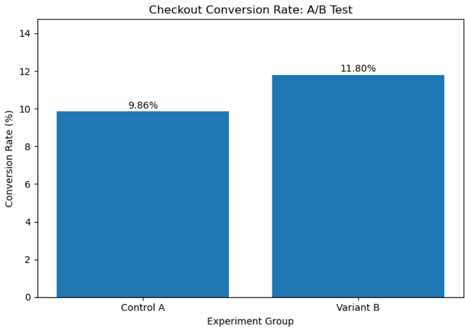
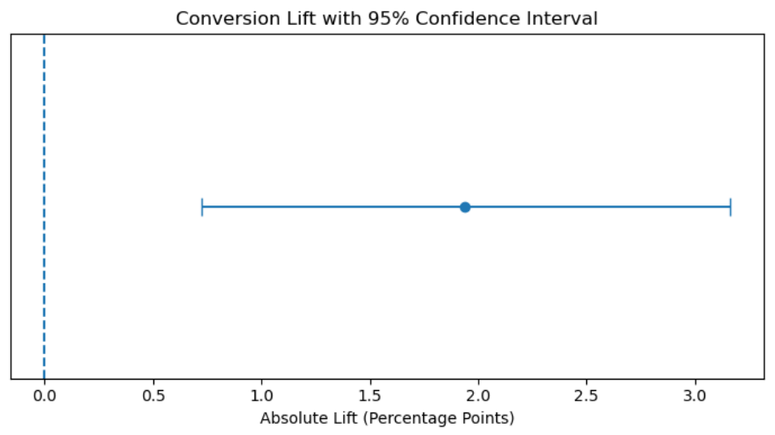
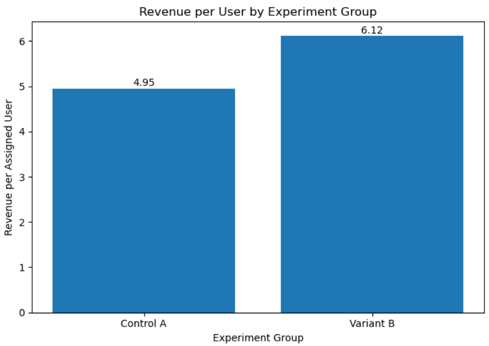
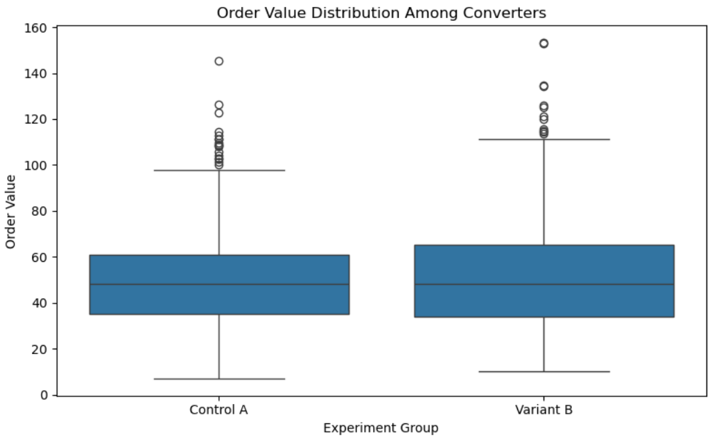
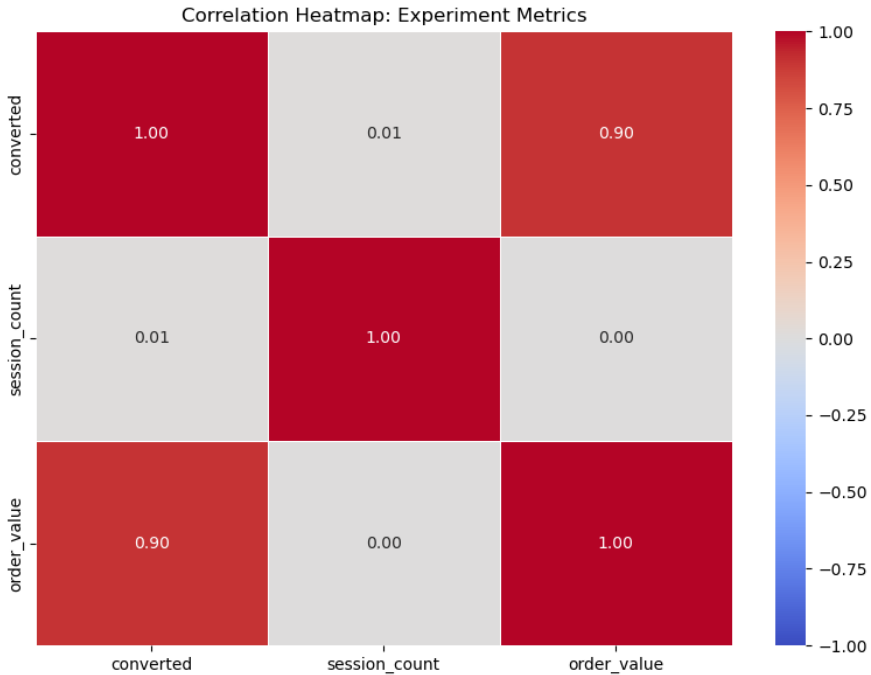

  
# 📊 Hypothesis Hub
## A/B Testing & Product Analytics Engine

### Test the Hypothesis. Measure the Impact. Decide with Confidence. 🧠

  

---

## 📖 Project Overview

**Hypothesis Hub** is a Python-based A/B testing and product analytics project designed to evaluate the impact of product changes through statistical analysis.

The project simulates an experiment involving **10,000 users**, divided equally between Control A and Variant B. It compares conversion performance, measures improvement, tests statistical significance, evaluates revenue metrics, and translates analytical findings into business recommendations.

By combining hypothesis testing, confidence intervals, revenue analysis, data validation, bootstrap resampling, and exploratory segmentation, Hypothesis Hub demonstrates a reproducible approach to data-driven product experimentation.

## 🎯 Objectives

- Compare conversion rates between Control A and Variant B.
- Calculate absolute and relative conversion lift.
- Evaluate statistical significance using a two-proportion z-test.
- Estimate 95% confidence intervals for conversion lift.
- Analyze revenue, average order value (AOV), and revenue per user.
- Validate data quality and check sample ratio mismatch.
- Use bootstrap resampling to estimate revenue uncertainty.
- Explore conversion patterns across session-count groups.
- Translate analytical findings into business recommendations.

## 📊 Experiment Overview

| Parameter | Details |
|:---|:---|
| Total Users | 10,000 |
| Control A | 5,000 users |
| Variant B | 5,000 users |
| Simulated Conversion Probability | A: 10%, B: 12% |
| Random Seed | 42 |
| Significance Level | 5% |
| Confidence Level | 95% |
| Primary Metric | Conversion Rate |
| Secondary Metrics | Revenue, AOV, Revenue per User |

## 📈 Key Results

### Conversion Performance

| Metric | Control A | Variant B |
|:---|---:|---:|
| Users | 5,000 | 5,000 |
| Conversions | 493 | 590 |
| Conversion Rate | 9.86% | 11.80% |

### Experiment Impact

| Metric | Result |
|:---|---:|
| Absolute Conversion Lift | +1.94 percentage points |
| Relative Conversion Lift | +19.68% |
| Additional Observed Conversions | +97 |
| Total Revenue Difference | +5,839.65 |
| Average Order Value Difference | +1.64 |
| Revenue-per-User Lift | +23.58% |

### 💰 Revenue Analysis

| Metric | Control A | Variant B |
|:---|---:|---:|
| Total Revenue | 24,761.67 | 30,601.32 |
| Average Order Value | 50.23 | 51.87 |
| Revenue per Assigned User | 4.95 | 6.12 |

*Revenue values are expressed in simulated currency units.*

## 🧠 Statistical Hypothesis Testing

A one-sided two-proportion z-test was conducted to evaluate whether Variant B achieved a higher conversion rate than Control A.

- **Z-statistic:** -3.1214 (based on the A − B difference)
- **P-value:** 0.000900
- **95% Confidence Interval for B − A Lift:** +0.72 to +3.16 percentage points
- **Significance Level:** 0.05

**Conclusion:** The null hypothesis is rejected at the 5% significance level. The simulated results provide statistically significant evidence that Variant B has a higher conversion rate than Control A.

## 🔁 Bootstrap Revenue Analysis

Bootstrap resampling was used to estimate uncertainty in the difference in revenue per assigned user.

- **Estimated Difference:** +1.17
- **95% Bootstrap Confidence Interval:** +0.49 to +1.84

The interval supports a positive revenue-per-user difference within this simulated dataset.

## ✅ Data Quality & Validation

The notebook includes automated checks for:

- Duplicate user IDs: **0**
- Missing values: **0**
- Balanced group sizes: **5,000 users per group**
- Valid binary conversion outcomes
- Negative order values
- Non-converting users with nonzero order values
- Sample ratio mismatch using a chi-square test

**SRM Result:** χ² = 0, p = 1.00. No sample ratio mismatch was detected in the simulated group counts.

## 🔍 Exploratory Segmentation

Conversion rates, absolute lift, and relative lift were calculated across session-count groups.

This analysis demonstrates how product analysts can explore differences between user segments.

**Note:** Session count was simulated independently of conversion. Therefore, subgroup findings are exploratory and should not be interpreted as causal or reliable real-world behavioral effects.

## 🏗️ Project Architecture

---

## 🛠️ Technology Stack

| Technology | Purpose |
|:---|:---|
| Python 3.12 | Programming and analysis |
| Pandas | Data manipulation and metric calculations |
| NumPy | Numerical operations and simulation |
| SciPy | Statistical testing |
| Statsmodels | Hypothesis testing and confidence intervals |
| Matplotlib | Data visualization |
| Seaborn | Statistical plots and heatmaps |
| Jupyter Notebook | Interactive analysis |
| Git & GitHub | Version control and project hosting |

## 📉 Visualizations

The notebook contains code for:

## 📂 Project Structure

    hypothesis-hub/
    ├── data/
    ├── notebooks/
    │   └── hypothesis_hub_analysis.ipynb
    ├── src/
    ├── outputs/
    ├── experiment_plan.md
    ├── requirements.txt
    ├── .gitignore
    └── README.md

## 🚀 Getting Started

### 1. Clone the Repository

    git clone https://github.com/Keya3639/Hypothesis-Hub.git
    cd Hypothesis-Hub

### 2. Create a Virtual Environment

    python -m venv .venv

Activate it using Windows PowerShell:

    .\.venv\Scripts\Activate.ps1

### 3. Install Dependencies

    pip install -r requirements.txt

### 4. Launch Jupyter Notebook

    jupyter notebook

Open `notebooks/hypothesis_hub_analysis.ipynb` and run the notebook cells.

## 💡 Key Learnings

- Translating business questions into measurable hypotheses
- Understanding absolute lift versus relative lift
- Applying statistical significance testing
- Interpreting p-values and confidence intervals
- Evaluating conversion and revenue metrics together
- Performing data-quality and sample ratio mismatch checks
- Using bootstrap resampling to estimate uncertainty
- Communicating analytical results through business recommendations

## ⚠️ Limitations

- The dataset is simulated, not collected from real users.
- Results demonstrate an analytical workflow, not a verified real-world product improvement.
- Statistical significance does not automatically imply business significance.
- Session-count segmentation is exploratory.
- Real-world rollout decisions require validation using production data and appropriate experimental controls.

## 🔮 Future Enhancements

- Integration with real product experiment data
- Bayesian A/B testing
- Sequential testing and early-stopping methods
- Multi-variant A/B/n testing
- Statistical power and sample-size calculator
- Automated guardrail monitoring
- Interactive experiment dashboard

---

# 👩‍💻 Developer

## Keya Das

**MCA — Artificial Intelligence & Data Science**

🌐 **GitHub:** [Keya3639](https://github.com/Keya3639)

📧 **Email:** keyakarunamoydas@gmail.com

---

# 🙏 Acknowledgements

This project was developed using the following open-source technologies and libraries:

- 🐍 Python
- 📊 Pandas & NumPy
- 📈 Matplotlib & Seaborn
- 🧪 SciPy & Statsmodels
- 📓 Jupyter Notebook
- 🌍 Open-source community

---

# 🧪 Hypothesis Hub

### Test Hypotheses. Measure Impact. Make Data-Driven Decisions. 📊

**Built with ❤️ using**

**Python • Pandas • NumPy • SciPy • Statsmodels • Matplotlib • Seaborn • Jupyter Notebook**

